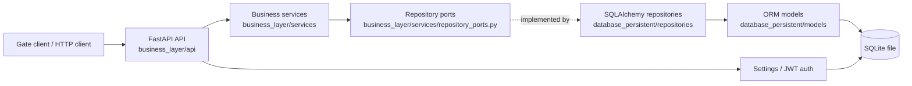
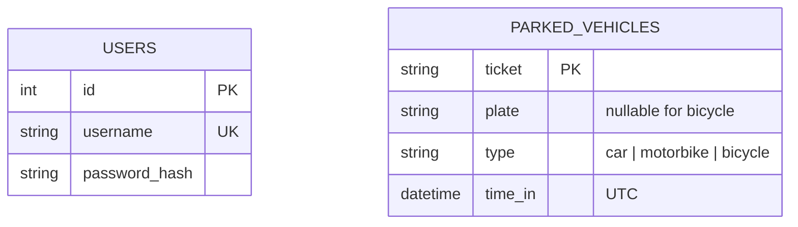

# Kiến trúc và mô hình dữ liệu Pha 1

## Phạm vi

Hệ thống quản lý lượt xe đang ở trong bãi: đăng nhập nhân viên, ghi nhận xe vào, tra cứu lượt gửi, liệt kê lượt gửi theo trang và lấy xe ra. Không có bảng giá, biểu phí, tính tiền hoặc trường `charge`.

## Thành phần và chiều phụ thuộc

API nhận HTTP, xác thực Bearer token và chuyển dữ liệu sang service. Service thực thi quy tắc nghiệp vụ thuần Python, chỉ biết các repository ports. Repository adapters ánh xạ port sang SQLAlchemy model/session. FastAPI dependencies trong `business_layer/dependencies.py` tạo session, repository và service cho mỗi request. Lỗi miền được ánh xạ thành HTTP/JSON ở `business_layer/main.py` và `business_layer/api/errors.py`.

Hai bảng không có quan hệ khóa ngoại: tài khoản xác thực nhân viên và lượt xe không cần liên kết một-một. DB áp dụng ràng buộc `ticket` dài 1–64, `plate` dài 1–15 nếu có, `type` thuộc ba giá trị hợp lệ, xe đạp không có biển số và ô tô/xe máy phải có biển số. `ticket` là khóa chính, vì vậy không thể có hai lượt đang hoạt động cùng vé. Một biển số có thể xuất hiện trên nhiều vé đang gửi.

`time_in` được chuẩn hóa về UTC. SQLite không giữ timezone trong giá trị `DATETIME`, nên `UTCDateTime` chuyển sang UTC trước khi ghi và gắn UTC khi đọc. Mật khẩu admin seed từ cấu hình được băm bcrypt; thao tác seed idempotent và chỉ thêm tài khoản khi username cấu hình chưa tồn tại.

## Khởi động và lưu trữ

Khi ASGI app `business_layer.main:app` chạy lifespan, `initialize_database()` tạo các bảng còn thiếu và seed tài khoản quản trị. Mặc định local dùng `sqlite:///./parking.db`; Docker Compose ghi DB vào `sqlite:////data/parking.db` trong named volume `parking_data`. `DATABASE_URL`, `JWT_SECRET`, thời hạn JWT và thông tin admin được đọc từ environment/`.env`; không đưa `.env` hoặc file DB vào Git.

Ứng dụng không cần dịch vụ Internet, OAuth hoặc dịch vụ DB ngoài trong lúc vận hành. JWT HS256 được xác minh bằng cấu hình cục bộ. Có thể sử dụng ở LAN/offline sau khi đã cài Python dependencies hoặc build image Docker. Lần cài dependencies/build image ban đầu cần các gói đã có sẵn hoặc truy cập package/image registry.

## Luồng request

1. `POST /api/v1/auth/login` kiểm tra bcrypt hash và cấp JWT có `sub`, `iat`, `exp`.
2. Parking router yêu cầu `Authorization: Bearer <token>` qua dependency dùng chung.
3. API xác thực/schema request rồi gọi `ParkingService`.
4. Service áp dụng quy tắc xe/vé và gọi repository port.
5. SQLAlchemy repository truy vấn hoặc ghi SQLite trong transaction do dependency session quản lý.
6. API chuyển kết quả hoặc lỗi miền thành response HTTP theo đặc tả; GET không thay đổi trạng thái, DELETE xóa lượt gửi khớp thông tin.

## Đối chiếu yêu cầu

Tài liệu gốc nằm trong [`specifications/`](specifications/README.md). API hiện triển khai login, POST gửi xe, GET tra cứu theo ticket, GET danh sách phân trang, DELETE lấy xe và `/health`. Xem [`decisions.md`](decisions.md) cho quyết định triển khai và [README](../README.md) cho lệnh cài đặt, Docker, test và benchmark.
