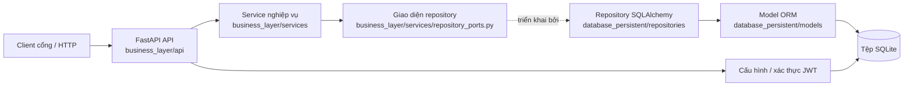
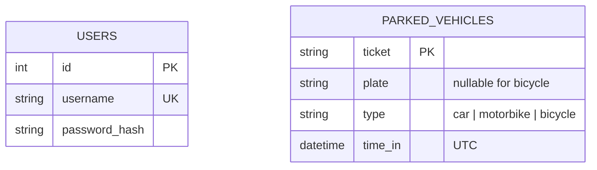

# Luồng hoạt động, ý nghĩa module và mô hình dữ liệu Pha 1

## Phạm vi

Hệ thống quản lý lượt xe đang ở trong bãi: đăng nhập nhân viên, ghi nhận xe vào, tra cứu lượt gửi, liệt kê lượt gửi theo trang và lấy xe ra. Chưa có bảng giá hay chức năng tính tiền tự động.

## Thành phần và chiều phụ thuộc

API nhận HTTP, xác thực Bearer token và chuyển dữ liệu sang service. Service kiểm tra quy tắc nghiệp vụ bằng Python thuần, chỉ biết các repository ports. Repository adapters ánh xạ port sang SQLAlchemy model/session. FastAPI dependencies trong `business_layer/dependencies.py` tạo session, repository và service cho mỗi request. Lỗi miền được ánh xạ thành HTTP/JSON ở `business_layer/main.py` và `business_layer/api/errors.py`.

## Ý nghĩa từng module

| Đường dẫn | Vai trò |
|---|---|
| `business_layer/main.py` | Tạo ứng dụng `business_layer.main:app`, khởi tạo DB khi chạy, đăng ký router và quy tắc chuyển ngoại lệ thành HTTP response. |
| `business_layer/config.py` | Đọc và kiểm tra cấu hình SQLite, JWT và tài khoản quản trị từ environment hoặc `.env`. |
| `business_layer/security.py` | Xác minh Bearer JWT và trả tên người dùng; router dùng dependency này để bảo vệ endpoint. |
| `business_layer/api/` | Nhận request, gọi service và tạo response: `auth_router.py` đăng nhập, `parking_router.py` gửi/tra cứu/lấy xe, `health_router.py` kiểm tra trạng thái, `errors.py` chuẩn hóa lỗi. |
| `business_layer/schemas/` | Khai báo kiểu dữ liệu, trường bắt buộc và response cho API bằng Pydantic. |
| `business_layer/dependencies.py` | Quản lý transaction/session và khởi tạo repository/service để FastAPI tiêm vào endpoint. |
| `business_layer/services/` | Thực thi quy tắc nghiệp vụ gửi xe, lấy xe, xác thực và các hợp đồng repository; không phụ thuộc FastAPI hoặc SQLAlchemy. |
| `database_persistent/db_config.py` | Tạo SQLAlchemy engine/session, lớp ORM nền và chuyển đổi timestamp UTC. |
| `database_persistent/models/` | Khai báo bảng `users` và `parked_vehicles`, kiểu cột, khóa và ràng buộc dữ liệu. |
| `database_persistent/repositories/` | Triển khai các repository ports bằng truy vấn SQLAlchemy trên phiên DB. |
| `database_persistent/seed.py` | Tạo schema và thêm tài khoản quản trị ban đầu bằng mật khẩu bcrypt nếu tài khoản chưa tồn tại. |
| `gate_client/gate_simulation.py` | Client dòng lệnh tương tác để đăng nhập, gửi xe, tra cứu và lấy xe qua HTTP. |
| `loadtest/locustfile.py` | Mô phỏng người dùng gửi, tra cứu rồi lấy xe trong vòng lặp tải. |
| `loadtest/kaggle_runner.sh` | Kiểm tra Backend, chạy Locust và lưu cấu hình cùng báo cáo benchmark. |
| `scripts/export_openapi.py` | Sinh tệp OpenAPI JSON để preview và review API trên GitHub. |
| `tests/` | Kiểm tra hợp đồng API, quy tắc nghiệp vụ, repository, xác thực và công cụ benchmark. |
| `docs/` | Lưu đặc tả gốc, quyết định, tài liệu luồng/module và baseline benchmark. |

Các thư mục `schemas/` và `loadtest/` chứa file thực thi nên không cần `.gitkeep`. Gate client chạy trực tiếp bằng Python; repo không đóng gói nó thành container riêng.

Hai bảng không có quan hệ khóa ngoại: tài khoản xác thực nhân viên và lượt xe không cần liên kết một-một. DB áp dụng ràng buộc `ticket` dài 1–64, `plate` dài 1–15 nếu có, `type` thuộc ba giá trị hợp lệ, xe đạp không có biển số và ô tô/xe máy phải có biển số. `ticket` là khóa chính, vì vậy không thể có hai lượt đang hoạt động cùng vé. Một biển số có thể xuất hiện trên nhiều vé đang gửi.

`time_in` được chuẩn hóa về UTC. SQLite không giữ timezone trong giá trị `DATETIME`, nên `UTCDateTime` chuyển sang UTC trước khi ghi và gắn UTC khi đọc. Mật khẩu admin seed từ cấu hình được băm bcrypt; thao tác seed idempotent và chỉ thêm tài khoản khi username cấu hình chưa tồn tại.

## Khởi động và lưu trữ

Khi ASGI app `business_layer.main:app` chạy lifespan, `initialize_database()` tạo các bảng còn thiếu và seed tài khoản quản trị. Mặc định local dùng `sqlite:///./parking.db`; Docker Compose ghi DB vào `sqlite:////data/parking.db` trong named volume `parking_data`. `DATABASE_URL`, `JWT_SECRET`, thời hạn JWT và thông tin admin được đọc từ environment/`.env`; không đưa `.env` hoặc file DB vào Git bằng cách dùng .gitignore.

Ứng dụng không cần dịch vụ Internet, OAuth hoặc dịch vụ DB ngoài trong lúc vận hành. JWT HS256 được xác minh bằng cấu hình cục bộ. Có thể sử dụng ở LAN/offline sau khi đã cài Python dependencies hoặc build image Docker. Lần cài dependencies/build image ban đầu cần các gói đã có sẵn hoặc truy cập package/image registry.

## Luồng request

1. `POST /api/v1/auth/login` nhận username/password; API gọi `AuthService`, service đọc hash qua `UserRepositoryPort`, repository lấy dữ liệu tài khoản từ SQLite và bcrypt kiểm tra mật khẩu.
2. Khi hợp lệ, API trả JWT HS256 có `sub`, `iat`, `exp`. Client gửi token ở header `Authorization: Bearer <token>` cho các endpoint bãi xe.
3. Dependency xác thực kiểm tra chữ ký, hạn dùng và claim `sub` trước khi endpoint nghiệp vụ chạy.
4. Pydantic schema kiểm tra cấu trúc request. Router chuyển dữ liệu hợp lệ sang `ParkingService`.
5. Service kiểm tra luật ticket/loại xe/biển số rồi gọi repository port. Repository SQLAlchemy đọc hoặc ghi SQLite trong transaction của request.
6. API trả response theo đặc tả. GET chỉ đọc dữ liệu; DELETE xóa lượt gửi sau khi xác nhận ticket, loại xe và biển số.

## Vòng đời khi khởi động

Uvicorn nạp `business_layer.main:app` → FastAPI chạy lifespan → `initialize_database()` tạo các bảng còn thiếu và seed admin → ứng dụng sẵn sàng nhận request. `/health` chỉ báo ứng dụng đang chạy; `/docs` hiển thị Swagger được sinh từ các router và schema.

## Đối chiếu yêu cầu

Tài liệu gốc nằm trong [`specifications/`](specifications/README.md). API hiện triển khai login, POST gửi xe, GET tra cứu theo ticket, GET danh sách phân trang, DELETE lấy xe và `/health`. Xem [`decisions.md`](decisions.md) cho quyết định triển khai và [README](../README.md) cho lệnh cài đặt, Docker, test và benchmark.
